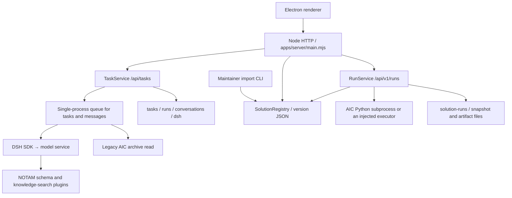

# SZH backend architecture

Review baseline: the local client polish on 2026-11-09. The runtime entry is `apps/server/main.mjs`, a native Node HTTP service. The desktop client is `apps/szh-app`. The Electron main process injects the Harness URL into the renderer. The older WinForms client loads the service web preview. Both can call the same backend.

## Modules and sources of truth

| Module | Responsibility |
| --- | --- |
| `main.mjs` | HTTP routes, request-body checks, error envelope, legacy preview allowlist. No auth middleware. |
| `tasks.mjs` | Lifecycle of tasks, attempts, and messages. The task snapshot is the source of truth for the legacy API. |
| `dsh-runner.mjs`, `task-activity.mjs` | One model turn through the DSH SDK, plugin setup, tool and assistant events. Archived activity can be read by session id. |
| `notam-profiles.mjs`, `parsing.mjs`, `report-parsing.mjs`, `notam-facts.mjs` | Mode selection, structured-response checks, and source-text facts. |
| `plugins/notam-schema.mjs`, `knowledge.mjs` | Expose `notam_schema` and `notam_reference`. Search the repository document index. |
| `aic-entry.mjs`, `aic-weekly-result.mjs` | Read and check existing AIC samples and experiment archives. Attach allowed artifacts. |
| `solution-registry.mjs`, `scripts/import-solution.mjs` | Validate a manifest, save a version file that cannot be overwritten, list and read versions. |
| `solution-runs.mjs` | Create a run, run a serial queue, call the executor, write artifact metadata. |

## Legacy tasks and the agent

After a NOTAM is created it waits in `awaiting_confirmation`. After confirmation it joins the queue shared with chat messages. The executor opens a new DSH session from the SDK profile and sets the model, task prompt, and specialist plugins. The first NOTAM turn requires both specialist tools to return, then checks JSON, fields, and source-text constraints. A passed check still waits for specialist review. The default model limit is 180 seconds and can be set from 10 to 300 seconds. Timeout or a user stop closes the SDK session. The task layer can continue from an existing response checkpoint.

General chat creates a `ready` task and sends the first message. Later messages carry completed turns and the current task context. The code does not reuse an existing DSH process as a long-lived chat session. The legacy AIC entry assembles materials on the same task queue. `runtime_executed` means the archive assembly ran. `model_called` stays false.

## Solutions, runs, and artifacts

- The maintainer CLI writes a manifest as `id@version.json` in the version directory. Startup does not import automatically. Input and output schemas are checked for compilability at registration. Execution validates input only. A version record contains a manifest snapshot. A model package is not locked to the version automatically.
- A run is bound to an explicit version and configuration. An in-process submit sequence checks the request id and fingerprint. Execution uses a separate serial queue from the legacy task queue. The run calls the configured executor and, on success, walks the output directory and records files. The AIC adapter calls Python on the Harness machine with a fixed script and arguments. It supports packaged case inference and a consistency review.
- Artifacts have no separate database. Metadata is embedded in the run. Download looks up the file by run id and artifact id. Legacy task files use another route and are read by attempt id and an allowed file name.
- Run saves use a temporary file and a rename. On startup, leftover `queued`, `running`, and `cancel_requested` runs are marked `failed`. There is no cross-process lock, heartbeat, automatic retry, or general remote scheduler.

## Data directory

The default data root is `var/` under the project root. An embedded service can pass `TaskService.open({ directory })` and use a separate root. The registry, runs, tasks, message artifacts, and DSH sessions stay inside that directory. Configuration sources are in the root [README](../../README.md).

| Relative directory | Contents |
| --- | --- |
| `tasks/<id>.json` | Legacy task and message snapshot, including source text, model result, and status |
| `runs/<attemptId>/` | Legacy task input, model receipt, checks, and result |
| `conversations/<taskId>/<messageId>/` | Patch and receipt for one model turn |
| `dsh/` | SDK sessions, archived activity, and runtime state |
| `solution-versions/` | Published version records |
| `solution-runs/<id>.json`, `solution-runs/<id>/` | New run snapshot and output files |

These directories can hold real user data or generated results, including personal chats. Keep the code repository and the runtime data separate for backup, authorization, and deployment. Do not copy runtime data into a source delivery.
